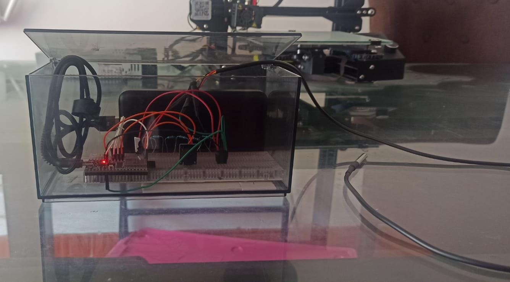
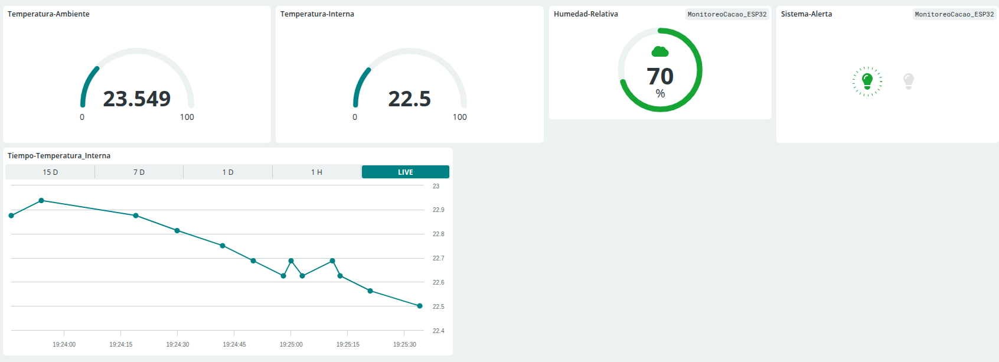

# Sistema de Monitoreo IoT para Fermentación de Cacao

Sistema de monitoreo en tiempo real para el proceso de fermentación del cacao, desarrollado para la Cooperativa de Cacao de Tocache, San Martín - Perú.

## Análisis de Necesidades y Problemática

### Contexto del Problema

Durante la visita a campo en Tocache se observó que la fermentación del cacao se realiza de manera empírica, sin registros estandarizados y con un alto nivel de variabilidad entre productores y cooperativas. Los productores se guían por experiencia personal (olor, color, tiempo aproximado y tacto), lo que genera diferencias en calidad entre lotes, incluso dentro de la misma campaña.

**Problemas identificados:**
- No existe un sistema que registre temperatura interna o humedad durante la fermentación
- No hay mecanismos que alerten sobre desviaciones en el proceso
- La falta de un registro estandarizado impide garantizar calidad homogénea y trazabilidad para compradores exigentes

**Impacto económico:**
- Pérdidas económicas por mala fermentación (30% - 50% de reducción del precio del grano)
- Lotes rechazados o degradados en calidad
- Dificultad para ingresar a mercados premium que exigen control y evidencia del proceso

### Descripción del Problema

La fermentación del cacao es una etapa crítica de la postcosecha que determina el sabor, aroma, color y calidad final del grano. En países productores como Perú, Colombia y Ecuador, este proceso se realiza mayoritariamente de forma artesanal y presenta una alta variabilidad según clima, humedad, manejo y experiencia del productor.

En regiones productoras como Tocache (San Martín), una de las zonas con mayor productividad del país, los pequeños agricultores fermentan en cajas artesanales o costales sin registrar temperatura ni humedad, lo que afecta la calidad del grano. Según MINAGRI, el 40% de los lotes no alcanzan el nivel óptimo de fermentación debido a fluctuaciones ambientales y falta de estandarización del proceso.

## Objetivos del Proyecto

### Objetivo General

Diseñar e implementar un sistema de monitoreo IoT para el proceso de fermentación del cacao en Tocache, capaz de registrar en tiempo real la temperatura y la humedad, y emitir alertas tempranas cuando los valores se desvíen del rango óptimo, con el fin de estandarizar al menos el 80% de las fermentaciones piloto y mejorar la calidad del grano de los productores locales.

### Objetivos Específicos

- Diseñar la arquitectura del sistema IoT con la ESP32 DevKit V4 e integrar los sensores de temperatura y humedad
- Integrar sensores económicos y disponibles en el mercado para medir temperatura y humedad
- Implementar la transmisión de datos en tiempo real hacia Arduino Cloud
- Diseñar un sistema de alertas sencillo (buzzer y notificación en dashboard)
- Construir un dashboard básico de registro histórico
- Validar el prototipo con productores y responsables de calidad
- Ajustar el diseño según retroalimentación real del usuario

## Presentación de la Solución

### Características de la Solución

#### 1. Arquitectura del Sistema

##### 1.1 Hardware Implementado

| Componente | Especificaciones |
|------------|-----------------|
| **Microcontrolador** | ESP32 (con conectividad WiFi integrada) |
| **Sensor SHT31** | Temperatura y humedad ambiental<br>Rango: -40°C a +125°C, 0% a 100% HR<br>Precisión: ±0.3°C y ±2% HR |
| **Sensor DS18B20** | Temperatura interna del grano<br>Rango: -55°C a +125°C<br>Precisión: ±0.5°C<br>Diseño para inmersión directa en la masa de cacao |
| **Buzzer pasivo** | Alertas sonoras ante desviaciones de parámetros |



##### 1.2 Conectividad y Comunicación

- **Conexión WiFi**: Integración con redes locales de la cooperativa
- **Portal Cautivo**: Sistema de configuración WiFi simplificado (Fermentacion_Setup)
- **Arduino IoT Cloud**: Plataforma para visualización y almacenamiento de datos en tiempo real

#### 2. Funcionalidades Principales

##### 2.1 Monitoreo en Tiempo Real

**Parámetros Monitoreados:**
- Temperatura ambiental (°C)
- Humedad relativa del ambiente (%)
- Temperatura interna del grano de cacao (°C)

**Frecuencia de Muestreo:**
- Lectura cada 30 segundos
- Transmisión inteligente (solo cambios significativos)

##### 2.2 Sistema de Alerta Inteligente

**Rangos Óptimos de Fermentación:**
- Temperatura ambiente: ≤ 45°C
- Temperatura crítica: 52°C (NO SUPERAR)
- Humedad relativa: 60% ≤ h ≤ 85%

**Alertas Activas:**
- Buzzer activa señal sonora cuando se exceden los límites
- Indicación visual en dashboard (estado de alerta)

##### 2.3 Dashboard en Tiempo Real



**Visualización de Datos:**
- Gráficos de tendencia temporal de temperatura y humedad
- Indicadores de estado actual (verde=óptimo / rojo=desviación)
- Historial de parámetros durante todo el proceso de fermentación
- Acceso remoto desde cualquier dispositivo con internet
- Exportación de datos en CSV para análisis posterior

#### 3. Ventajas Competitivas

##### 3.1 Para la Cooperativa

**Automatización del Control**
- Elimina la necesidad de medición manual constante
- Libera al personal para otras actividades productivas
- Reduce el riesgo de error humano en las lecturas

**Reducción de Pérdidas**
- Detección temprana de condiciones adversas (sobrecalentamiento, baja humedad)
- Prevención de fermentación defectuosa que afecta calidad del cacao
- Minimiza pérdidas económicas por lotes rechazados

##### 3.2 Ventajas Técnicas

- **Bajo costo**: Componentes accesibles y de fácil reemplazo
- **Fácil instalación**: No requiere modificaciones estructurales en cajas de madera
- **Autonomía**: Sistema autoconfigurado con portal WiFi propio
- **Mantenimiento mínimo**: Sensores robustos con larga vida útil
- **Acceso remoto**: Monitoreo desde cualquier ubicación con internet

## Primeros Pasos

### Requisitos Previos

- PlatformIO instalado
- Cuenta de Arduino IoT Cloud configurada
- Hardware: ESP32, SHT31, DS18B20, Buzzer
- Librerías necesarias instaladas

### Instalación

```bash
# Clonar o descargar el proyecto
cd prueba_sht31

# Instalar dependencias
pio lib install

# Compilar el proyecto
pio run
```

### Configuración Inicial

1. Conectar el hardware según el diagrama de pines
2. Cargar el firmware al ESP32
3. Encender el dispositivo
4. Conectarse al WiFi: `Fermentacion_Setup` (contraseña: `cacao2025`)
5. Abrir navegador en: `http://192.168.4.1`
6. Configurar las credenciales de la red WiFi local

## Proceso de Uso

### 1. Preparación del Sistema

1. Colocar el sensor DS18B20 inmerso en la masa de cacao
2. Posicionar el sensor SHT31 en el ambiente cercano a la caja de fermentación
3. Encender el dispositivo ESP32
4. Esperar la señal sonora de conexión exitosa (2 pitidos cortos)

### 2. Monitoreo Durante la Fermentación

- El sistema registra automáticamente temperatura y humedad cada 30 segundos
- Los datos se transmiten en tiempo real a Arduino IoT Cloud
- El buzzer activará alertas si los parámetros exceden los rangos óptimos
- El dashboard muestra el estado actual del proceso

### 3. Análisis de Datos

1. Acceder al dashboard de Arduino IoT Cloud
2. Visualizar los gráficos de tendencia
3. Exportar los datos en CSV para análisis detallado
4. Comparar resultados entre diferentes lotes de fermentación

## Estructura del Proyecto

```
prueba_sht31/
├── src/
│   ├── main.cpp              # Archivo principal (setup y loop)
│   ├── thingProperties.h     # Configuración Arduino IoT Cloud
│   ├── config/               # Configuración del sistema
│   │   └── config.h         # Constantes y parámetros de fermentación
│   ├── sensors/              # Módulo de sensores
│   │   └── sensors.h         # Inicialización y lectura de sensores
│   ├── wifi/                 # Módulo WiFi
│   │   └── wifi_manager.h    # Gestión de conexión WiFi y portal cautivo
│   ├── monitoring/           # Módulo de monitoreo
│   │   └── monitoring.h      # Lógica de monitoreo y alertas
│   └── html/                 # Páginas HTML del portal
│       └── pages.h           # Formularios y páginas web
├── images/                   # Imágenes del sistema y dashboard
│   ├── Sistema.jpeg
│   └── dashboard.png
├── platformio.ini
├── README.md
└── INSTRUCCIONES_COOPERATIVA.md
```

## Configuración de Hardware

| Componente | Pin ESP32 | Descripción |
|------------|-----------|-------------|
| SHT31 SDA | GPIO 26 | I2C Data |
| SHT31 SCL | GPIO 27 | I2C Clock |
| DS18B20 | GPIO 4 | OneWire |
| Buzzer | GPIO 25 | Salida digital (activo en LOW) |

## Parámetros Configurables

Los parámetros de fermentación se pueden ajustar en `src/config/config.h`:

```cpp
const float TEMP_IDEAL_MAX = 45.0;      // Temperatura ideal máxima
const float TEMP_CRITICA_MAX = 52.0;    // Temperatura crítica
const float HUMEDAD_MIN = 60.0;         // Humedad mínima
const float HUMEDAD_MAX = 85.0;         // Humedad máxima
const unsigned long INTERVALO_LECTURA = 30000;  // Intervalo en ms
```

## Compilación y Carga

```bash
# Compilar el proyecto
pio run

# Cargar al dispositivo ESP32
pio run --target upload

# Monitor serial para depuración
pio device monitor
```

## Resultados Esperados

- **Estandarización**: 80% de las fermentaciones dentro de rangos óptimos
- **Reducción de pérdidas**: Disminución del 30% en lotes rechazados
- **Mejora de calidad**: Incremento en el precio del grano por mejor fermentación
- **Trazabilidad**: Registro histórico completo de cada lote
- **Accesibilidad**: Monitoreo remoto desde cualquier ubicación

## Requisitos de Software

- PlatformIO Core
- Arduino IoT Cloud
- Librerías:
  - WiFi
  - WebServer
  - Preferences
  - Wire
  - Adafruit SHT31
  - OneWire
  - DallasTemperature
  - ArduinoIoTCloud

## Versión

v1.1 - Modo Portátil Corregido - 2025

## Autores y Colaboradores

Cooperativa de Cacao - Tocache, San Martín - Perú

## Licencia

Proyecto desarrollado para fines de mejora de la calidad del cacao en la región de San Martín.
